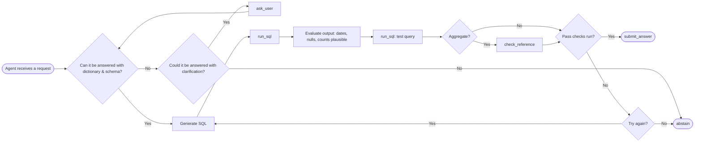

# Agent v1 flow
# Drawn Oct 20, 2026
# matches agent_v1.py 

**Tools (5)**: ask_user(dimension, question) · run_sql(sql) · check_reference(metric) · submit_answer(sql, result) · abstain(route_to, has_output, reason)

Prompt instructions: state ask / answer / abstain before acting · if asking, name the dimension from the five · state whether the request yields a number, a list, or an explanation · before submitting, state whether the result is plausible · a question about the data is answered in text and supported by a query

**Caps**: ask_user 3 · try_again 3 · 30 calls per run

**Run ends on**: submit_answer, abstain, a cap, or an error (logged)